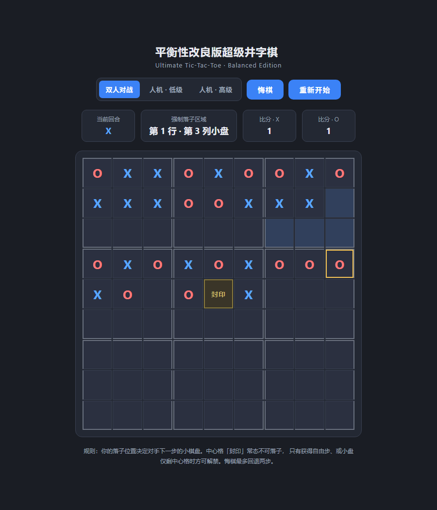

# 平衡性改良版超级井字棋（Ultimate Tic-Tac-Toe）

一个使用 **Vibe Coding** 开发的单文件网页游戏 —— 在经典「超级井字棋（Ultimate Tic-Tac-Toe）」基础上，加入中心格封印机制来改良先后手平衡性的双人对战小游戏。

## 项目用途

- 提供一款规则新颖、可直接在浏览器中运行的双人策略棋类游戏。
- 作为 Vibe Coding 的示意项目：全程通过 AI Agent 对话式生成，验证「自然语言描述需求 → 生成可运行代码」的开发流程。

## 如何运行

无需安装任何依赖，直接用浏览器打开即可：

```
双击 ultimate-tic-tac-toe.html
```

或任意静态服务器（如 `python -m http.server`）托管后访问。

## 运行截图



## 游戏规则

在经典 9×9 超级井字棋的基础上，做了以下设计与平衡性改良：

### 基础机制
1. **棋盘**：9×9 大网格，划分为 9 个 3×3 的「小棋盘」。
2. **引导规则**：玩家落子的具体位置，决定对手下一步必须在哪个小棋盘落子。
3. **小盘胜负**：某玩家在小棋盘内横、竖、斜连成三子，即占领该小盘，被占领的小盘锁定。
4. **大盘胜负**：通过占领的小盘在大棋盘上连成三子，直接获胜。

### 特殊开局限制
5. 先手（X）第一手必须落在正中间小棋盘内。
6. 第一手不能落在整个棋盘的最中心格 `[4,4]`。

### 中心格封印与解禁机制（核心创新点）
7. **常态封印**：最中心格 `[4,4]` 正常情况下不可落子。
8. **解禁条件 A（自由步）**：当玩家被引导至「已被占领」或「已下满」的小棋盘时，获得自由落子权，可在全场任意空位落子（含中心格）。
9. **解禁条件 B（防死锁）**：若被引导的小棋盘只剩中心格一个空位，允许直接落子在中心格。
10. 中心格落子后，对手按常规引导规则被强制引导至正中间小棋盘。

### 终局结算
11. 优先判定：任一方达成大棋盘三连直接获胜。
12. 计分判定：9 个小棋盘全部结束后，比较双方占领的小棋盘数量。
13. 后手补偿：玩家 O 的最终得分 = 占领小盘数 + 1。
14. 分数高者获胜，相同则平局。

## 玩法与模式

- **双人对战**：两人轮流在本地落子。
- **人机对战 · 低级**：AI 在合法位置随机落子，适合新手练习。
- **人机对战 · 高级**：AI 采用启发式打分策略——优先抢占中心格、直接占领小盘、防守对手成三、评估小盘威胁与大盘战略位置。
- **悔棋**：最多回退两步；人机模式下会自动回退到「轮到自己」的干净局面。

## 设计思路

经典超级井字棋存在一个公认的平衡性问题：**先手（X）拥有过大的优势**，因为先手可以牢牢控制引导节奏，让对手反复陷入被动。

本项目通过引入「中心格封印」机制来缓解这一劣势：

- 最中心格 `[4,4]` 是唯一一个「引导它 = 引导到正中间小盘」的格子，具有极高的战略价值。
- 常态封印它，剥夺了先手在开局阶段抢占这一战略高地的能力，同时让后手在特定条件下（自由步 / 防死锁）获得解锁它的机会。
- 后手补偿分（+1）进一步从结算层面拉平先后手差距。

这样在保留原版核心乐趣的同时，让对局更加均衡、更具策略深度。

## 技术实现

- **纯前端**：单文件 `ultimate-tic-tac-toe.html`，内含 HTML / CSS / JavaScript，零依赖。
- **CSS Grid**：用 `repeat(9, 1fr)` 搭建 9×9 网格，通过 CSS 变量动态控制单元格四边的粗细，实现小棋盘的粗边框分隔。
- **状态管理**：用二维数组 `board[9][9]` 记录落子，`subOwner[3][3]` 记录小盘占领状态，`forcedSub` 记录强制引导区域。
- **解禁逻辑**：`canPlayCenter()` 与 `isCenterUnsealedNow()` 统一驱动中心格的封印/解禁判定，保证点击逻辑与视觉状态一致。
- **AI 对手**：`aiChooseEasy()` 随机落子；`aiChooseHard()` 通过 `evaluateMove()` 启发式打分（占小盘 100 分、防守 80 分、中心格 30 分、威胁评估等），选最高分位置。
- **悔棋**：每次落子前用 `snapshot()` 深拷贝状态入栈，`doUndo()` 出栈回退，最多两步。

## 项目结构

```
.
├── ultimate-tic-tac-toe.html   # 游戏主文件（含全部 HTML/CSS/JS）
├── screenshot.png              # 游戏运行截图
└── README.md                   # 本说明文档
```

## 致谢

本项目由 WorkBuddy（AI Agent）通过 Vibe Coding 方式生成。
